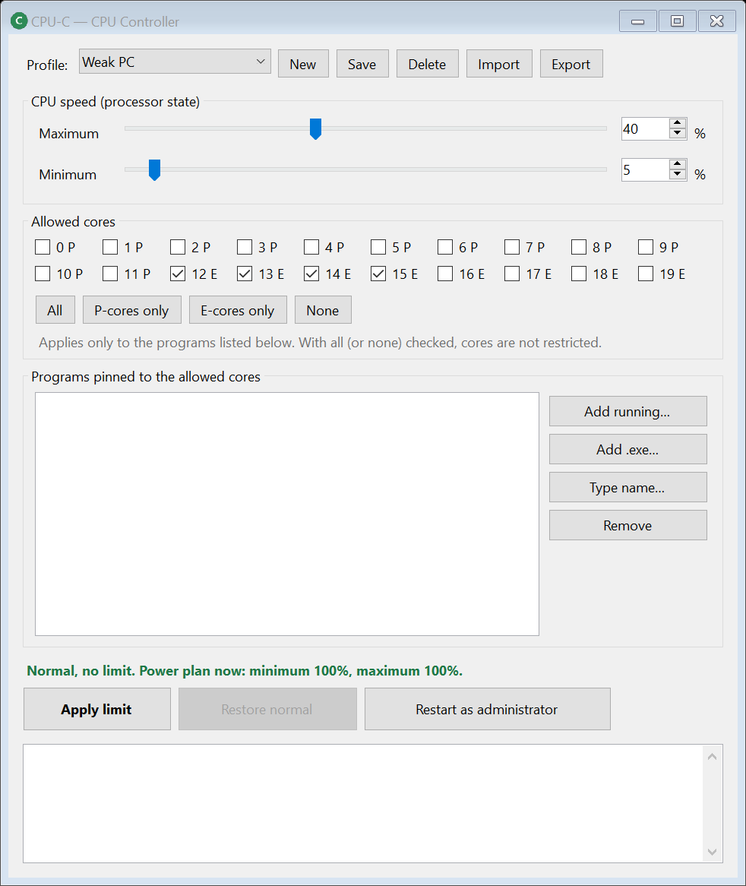

# CPU-C

**CPU Controller** for Windows: temporarily weakens your processor so you can test games and apps as if on a low-end PC, then puts everything back with one click.

*Resumo em português no [final](#português).*



## What it does

- **Limits CPU speed** by changing the minimum and maximum processor state of the active power plan.
- **Pins programs to a few cores**, labelling which are P-cores (fast) and E-cores (slow) on hybrid processors.
- **Watches the listed programs**: if the game is started or restarted later, its cores are pinned automatically.
- **Profiles** saved as JSON, with import and export.
- **Guaranteed restore**: the original values are saved before any change. Closing the app restores the CPU, and if the app is killed, it offers to restore the next time it opens.
- **Tray icon** to switch profiles or restore without opening the window.

## Install

Download `CPU-C.exe` from the [Releases](../../releases) page and run it. It is a single file and does not need .NET installed.

The executable is not code-signed, so Windows SmartScreen and some antivirus programs may show a warning on first run.

Requirements: Windows 10 or 11, 64-bit.

## Usage

1. Pick a profile or adjust the values on screen.
2. Under **Programs**, add the game or app that should be pinned to the checked cores.
3. Click **Apply limit**.
4. When you are done, click **Restore normal** or close the app.

To confirm the limit took effect, open Task Manager → Performance → CPU and watch the **Speed** drop.

### Tips

- The speed limit applies to the **whole system**; the core selection applies only to the listed programs.
- 30% to 50% usually simulates a modest PC well. At 10% or below, all of Windows may become very slow.
- On CPUs with Hyper-Threading, two neighbouring logical CPUs (0 and 1, 2 and 3...) are usually the same physical core. Hover over a checkbox to see.
- If a program runs as administrator, use **Restart as administrator** so CPU-C can pin its cores.

### Command line

```
CPU-C.exe --apply "Weak PC"    applies a saved profile and exits (the limit stays active)
CPU-C.exe --restore            restores the CPU to normal
CPU-C.exe --status             shows the current state
```

## Where data is stored

`%AppData%\CPU-C\profiles.json` holds the profiles. `state.json`, in the same folder, exists only while a limit is active and holds the original power plan values.

## Limitations

- Machines with more than 64 logical CPUs (multiple processor groups) are not supported.
- The limit changes whichever power plan is active at the moment it is applied.
- On some laptops the manufacturer ignores the maximum processor state, and the speed does not drop.

## Build

Requires the .NET 10 SDK.

```
dotnet build
dotnet run --project src/CPU-C
```

To produce the single-file executable:

```
dotnet publish src/CPU-C/CPU-C.csproj -c Release -r win-x64 --self-contained true -p:PublishSingleFile=true -p:IncludeNativeLibrariesForSelfExtract=true -p:EnableCompressionInSingleFile=true -o publish
```

Pushing a `v*` tag (for example `v0.1.0`) makes GitHub Actions build it and create the release.

## Disclaimer

Use at your own risk. The program changes Windows power settings and process affinity; nothing is permanent, but very low limits can leave the system almost unresponsive until you restore.

## Português

O CPU-C (CPU Controller) enfraquece o processador temporariamente no Windows para você testar jogos e programas como se estivesse num PC fraco. Ele limita o estado do processador no plano de energia ativo, prende os programas escolhidos a poucos núcleos (P-cores e E-cores vêm identificados), vigia esses programas para quando abrirem e guarda as configurações em perfis JSON. Os valores originais são salvos antes de qualquer mudança e restaurados ao clicar em **Restore normal** ou fechar o app. A interface está em inglês.

Baixe o `CPU-C.exe` em [Releases](../../releases); não é preciso instalar o .NET. O uso é por sua conta e risco.

## License

[MIT](LICENSE)
